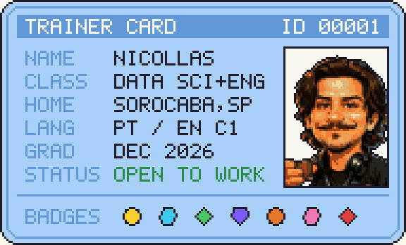
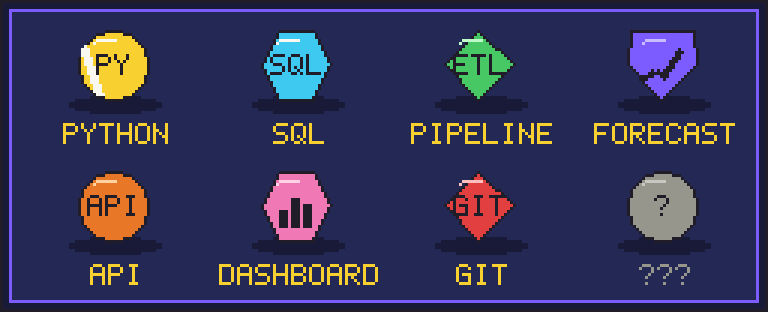

  

## 🎮 What will you do?

<table>
<tr>
<td width="50%" valign="top">

<b>⚔️ FIGHT</b>

 

| Move | Type | Effect |
|---|---|---|
| **ETL PIPELINE** | Data Eng. | Collects, cleans and loads data, with automated tests |
| **FORECAST** | ML | Time-series models validated walk-forward |
| **SQL QUERY** | Databases | SQL Server · MySQL: joins, filters, extraction |
| **PYTHON** | Core | pandas · NumPy · scikit-learn |
| **DASHBOARD** | Analytics | Power BI reports people actually use |

</td>
<td width="50%" valign="top">

<b>🎒 BAG</b>

 

🔮 **[Poultry Price Forecasting](https://github.com/nicollascamargo/previsao-precos-avicultura)** 
Key item. Predicts prices 1 to 3 months ahead, served through FastAPI.

📡 **[Data Job Radar](https://github.com/nicollascamargo/data-job-radar)** 
Finds data jobs that match my CV twice a day and sends them to Telegram.

📦 **[Agro Sales Pipeline](https://github.com/nicollascamargo/pipeline-vendas-agro)** 
ETL pipeline for agribusiness sales data, with automated tests.

🗂️ **Click Manager** 
ASP.NET Core web system with JWT auth and SQL Server (PIM III).

</td>
</tr>
<tr>
<td width="50%" valign="top">

<b>👥 TEAM</b>

 

**NICOLLAS wants to join your team!**

 

</td>
<td width="50%" valign="top">

<b>🏃 RUN</b>

 

**Can't escape!** 
NICOLLAS is open to data internships and junior roles.

🏆 Secret found. [Send a message with the subject "I tried to run"](mailto:nicollascamargo81@gmail.com?subject=I%20tried%20to%20run) and it's a coffee chat.

</td>
</tr>
</table>

## 🪪 Trainer Card

 

**Systems Analysis and Development** student at UNIP Sorocaba, graduating in December 2026, with 220+ hours of training in Data Science, Data Engineering and Machine Learning. I build pipelines, forecasts and APIs, and I test them before trusting them.

## 🏅 Badge Case

 

| Badge | Earned by |
|---|---|
| 🟡 **PYTHON** | pandas, NumPy and scikit-learn across my data projects |
| 🔵 **SQL** | Queries, joins and relational modeling on SQL Server and MySQL |
| 🟢 **PIPELINE** | ETL that collects, cleans and loads data, with automated tests |
| 🟣 **FORECAST** | Time-series models validated walk-forward, month by month |
| 🟠 **API** | FastAPI and ASP.NET Core services, with authentication |
| 📊 **DASHBOARD** | Power BI dashboards and data visualization |
| 🔴 **GIT** | Git and GitHub for every project, CI and scheduled GitHub Actions |
| 🔒 **???** | Not earned yet. The next gym is on the map. |

## 📜 Quest Log

<table>
<tr>
<td width="50%" valign="top">

✅ **QUEST COMPLETE**

### [Poultry Price Forecasting](https://github.com/nicollascamargo/previsao-precos-avicultura)

Predicts poultry prices 1 to 3 months ahead from feed cost, exchange rate and inflation. Validated walk-forward, beats the naive baseline at every horizon and is served through a FastAPI API with tests and CI.

`Python` · `scikit-learn` · `FastAPI` 
Reward: 🟣 FORECAST · 🟠 API

</td>
<td width="50%" valign="top">

✅ **QUEST COMPLETE**

### [Data Job Radar](https://github.com/nicollascamargo/data-job-radar)

Searches LinkedIn, Indeed, Glassdoor and Adzuna twice a day for junior and internship data jobs, compares each one with the skills in my CV and sends the best ones to Telegram.

`Python` · `SQLite` · `GitHub Actions` 
Reward: 🟢 PIPELINE · 🔴 GIT

</td>
</tr>
<tr>
<td width="50%" valign="top">

✅ **QUEST COMPLETE**

### [Agro Sales Pipeline](https://github.com/nicollascamargo/pipeline-vendas-agro)

ETL pipeline in Python that consolidates and processes agribusiness sales data, with automated tests for the dashboards it generates.

`Python` · `pandas` · `ETL` 
Reward: 🟢 PIPELINE · 📊 DASHBOARD

</td>
<td width="50%" valign="top">

✅ **QUEST COMPLETE · ACADEMY**

### Click Manager

Web management system for a photography studio: JWT authentication, relational database modeling, accessibility documentation (LIBRAS) and a module applying Machine Learning.

`ASP.NET Core 8` · `Entity Framework Core` · `SQL Server` 
Reward: 🟠 API · 🔵 SQL

</td>
</tr>
<tr>
<td colspan="2" valign="top">

🔒 **NEXT QUEST** · **House Price Prediction**: regression with feature engineering and model comparison. `Python` · `scikit-learn` · Reward: ???

</td>
</tr>
</table>

## 🗺️ World Map

| | Stage | |
|:---:|---|---|
| 🏠 | **TATUÍ** · 2022 | Sales and customer service: inventory control in Excel, spotting inconsistencies in the data |
| 🏫 | **UNIP SOROCABA** · Feb 2025 | Systems Analysis and Development begins |
| 🌲 | **TRAINING FOREST** | 220+ hours of Data Science, Data Engineering, AI and Data Analysis |
| ⛰️ | **PROJECT PEAK** | Four quests complete: forecasting, ETL, a job radar and a web system |
| 📍 | **YOU ARE HERE** | Studying statistics for data science, machine learning and data engineering |
| 🏆 | **DEC 2026** | Graduation, and the first data role |
| 🌍 | **POST-GAME** | A data career and further studies abroad |

## 💾 Save Point

**Would you like to save your progress?**

  

  

