## 🛰️ Incoming Transmission

 

**Systems Analysis and Development** student at UNIP Sorocaba, graduating in December 2026, with 220+ hours of training in Data Science, Data Engineering and Machine Learning. I build pipelines, forecasts and APIs, and I test them before trusting them.

> *"Do. Or do not. There is no `try`."* 
> A very old Jedi Master, reviewing my error handling

## 🎮 Choose Your Side

<table>
<tr>
<td width="50%" valign="top">

<b>🔵 LIGHT SIDE</b>

 

**The Rebellion welcomes you.** 
NICOLLAS is open to **data internships** and **junior roles** in Data Science, Data Engineering and Analytics.

 

</td>
<td width="50%" valign="top">

<b>🔴 DARK SIDE</b>

 

*"I find your lack of tests disturbing."*

Every project here ships with automated tests, so the Empire's bugs never reach production.

🏆 **Secret found.** [Send a message with the subject "I chose the Dark Side"](mailto:nicollascamargo81@gmail.com?subject=I%20chose%20the%20Dark%20Side) and the coffee is on me. ☕

</td>
</tr>
<tr>
<td width="50%" valign="top">

<b>🟢 ASK YODA</b>

 

*"Hire this Padawan, you must. Strong with the data, this one is. Tested, every pipeline is. Hmmm."*

</td>
<td width="50%" valign="top">

<b>🤖 TALK TO R2-D2</b>

 

`01001000 01001001 01010010 01000101`

Translation by C-3PO: R2 says, and I quote, <b>"HIRE"</b>. Rather direct, if you ask me.

</td>
</tr>
</table>

## ⚔️ Lightsaber Arsenal

 

| Crystal | Blade | Attuned through |
|:---:|---|---|
| 🔵 | **PYTHON** | pandas, NumPy and scikit-learn across my data projects |
| 🟢 | **SQL** | Queries, joins and relational modeling on SQL Server and MySQL |
| 🟣 | **PIPELINES** | ETL that collects, cleans and loads data, with automated tests |
| 🟡 | **FORECASTING** | Time-series models validated walk-forward, month by month |
| ⚪ | **APIs** | FastAPI and ASP.NET Core services, with authentication |
| 🟠 | **DASHBOARDS** | Power BI dashboards and data visualization |
| ⚫ | **GIT & CI** | The Darksaber: Git and GitHub on every project, CI and scheduled GitHub Actions |
| 🔒 | **???** | Crystal not found yet. The next trial awaits on Ilum. |

## 📜 Mission Log

<table>
<tr>
<td width="50%" valign="top">

✅ **MISSION ACCOMPLISHED**

### [Poultry Price Forecasting](https://github.com/nicollascamargo/previsao-precos-avicultura)

Predicts poultry prices 1 to 3 months ahead from feed cost, exchange rate and inflation. Validated walk-forward, beats the naive baseline at every horizon and is served through a FastAPI API with tests and CI.

`Python` · `scikit-learn` · `FastAPI` 
Crystals: 🟡 FORECASTING · ⚪ APIs

</td>
<td width="50%" valign="top">

✅ **MISSION ACCOMPLISHED**

### [Data Job Radar](https://github.com/nicollascamargo/data-job-radar)

Searches LinkedIn, Indeed, Glassdoor and Adzuna twice a day for junior and internship data jobs, compares each one with the skills in my CV and sends the best ones to Telegram.

`Python` · `SQLite` · `GitHub Actions` 
Crystals: 🟣 PIPELINES · ⚫ GIT & CI

</td>
</tr>
<tr>
<td width="50%" valign="top">

✅ **MISSION ACCOMPLISHED**

### [Agro Sales Pipeline](https://github.com/nicollascamargo/pipeline-vendas-agro)

ETL pipeline in Python that consolidates and processes agribusiness sales data, with automated tests for the dashboards it generates.

`Python` · `pandas` · `ETL` 
Crystals: 🟣 PIPELINES · 🟠 DASHBOARDS

</td>
<td width="50%" valign="top">

✅ **MISSION ACCOMPLISHED · ACADEMY**

### Click Manager

Web management system for a photography studio: JWT authentication, relational database modeling, accessibility documentation (LIBRAS) and a module applying Machine Learning.

`ASP.NET Core 8` · `Entity Framework Core` · `SQL Server` 
Crystals: ⚪ APIs · 🟢 SQL

</td>
</tr>
<tr>
<td colspan="2" valign="top">

🛠️ **MISSION IN PROGRESS · TEST VERSION**

### [Runa 3D](https://github.com/nicollascamargo/runa-3d)

A 3D tactical RPG controlled with **hand gestures through the webcam**: trace runes in the air with your finger to cast spells, or swing a sword with two fingers. Basically, using the Force. [Play it in the browser](https://nicollascamargo.github.io/runa-3d/) (Chrome on a computer).

`JavaScript` · `Three.js` · `MediaPipe`

</td>
</tr>
<tr>
<td colspan="2" valign="top">

🔒 **CLASSIFIED · NEXT MISSION** · **House Price Prediction**: regression with feature engineering and model comparison. `Python` · `scikit-learn`

</td>
</tr>
</table>

<i>These aren't the bugs you're looking for. The tests already caught them.</i>

## 🌌 Hyperspace Route

 

| | Stop | |
|:---:|---|---|
| 🏜️ | **TATUÍ** · 2022 | Practically Tatooine. Sales and customer service: inventory control in Excel, spotting inconsistencies in the data |
| 🏙️ | **UNIP SOROCABA** · Feb 2025 | The academy: Systems Analysis and Development begins |
| 🌿 | **DAGOBAH** | 220+ hours of Data Science, Data Engineering, AI and Data Analysis training |
| ☁️ | **CLOUD CITY** | Four missions shipped: forecasting, ETL, a job radar and a web system |
| 📍 | **YOU ARE HERE** | Studying statistics for data science, machine learning and data engineering |
| ⚔️ | **KNIGHTHOOD** · Dec 2026 | Graduation, and the first data role |
| 🌌 | **OUTER RIM** | A data career and further studies abroad |

## 🚀 Make the Jump

  

**Ready to bring a Padawan onto your crew?**

  

  

A fan tribute built with Python, SVG and the Force. Star Wars belongs to Lucasfilm.

